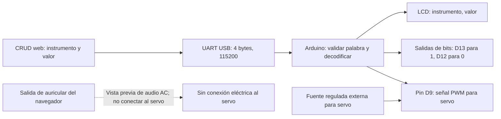

# Control del servo desde el envío

> Diseño de laboratorio no certificado. El auricular no es una salida de continua calibrada y nunca debe conectarse directamente a un servo. El firmware usa el valor decodificado y controla el servo por PWM desde Arduino.

## Bloques recomendados

La tierra de la señal PWM y la fuente del servo deben seguir las indicaciones del servo/controlador y el diseño de alimentación. No unir tierras si una interfaz aislada exige mantener aislamiento.

## Guía funcional

1. **Escalado:** el firmware mapea el valor recibido desde el rango configurado del instrumento al intervalo de ángulo limitado (por defecto 20°–160°). Ajustar esos límites para el mecanismo real antes de conectar la carga; no todos los servos permiten todo el recorrido.
2. **Señal:** Arduino genera la señal de control PWM en el pin D9 usando la biblioteca `Servo`. No es una salida analógica DC: es una señal de pulsos codificada temporalmente para la entrada de control del servo.
3. **Potencia:** alimentar el servo con una fuente regulada adecuada a su corriente de arranque. No tomar corriente del pin 5 V del Arduino. Conectar las referencias de señal conforme a las instrucciones del servo y la arquitectura de aislamiento.
4. **Prueba:** primero probar sin carga mecánica, revisar sentido de movimiento y topes, y ajustar recorrido/tiempos. Mantener el servo desconectado durante las pruebas eléctricas iniciales.

## Advertencias y límite de esta aplicación

La aplicación web crea el envío con instrumento, valor y límites mínimo/máximo del instrumento, genera una palabra ARINC 429 de demostración y la manda por UART si `SERIAL_ENABLED=true`. El navegador también puede reproducir un tono de 440 Hz como vista previa:

$$x = \frac{valor - mínimo}{máximo - mínimo}, \qquad ganancia = 0.15x$$

La vista previa es audio AC digital; la tensión de auricular depende del DAC, volumen, carga y sistema operativo. No es continua calibrada, no equivale al valor de envío y no debe usarse para controlar un servo. El servo se controla separadamente con el valor decodificado y PWM de Arduino. Nunca conectar la salida de auricular directamente al servo o a una entrada eléctrica sin una etapa diseñada y validada.

La transmisión serial de la demo entrega cuatro bytes por UART: no genera temporización, bipolaridad ni niveles eléctricos ARINC429. Al habilitar `SERIAL_ENABLED=true`, la creación de un envío intenta transmitir automáticamente; debe usarse solo con una interfaz de laboratorio compatible, limitada y aislada. Para un bus ARINC 429 real se necesita un transmisor apropiado.
