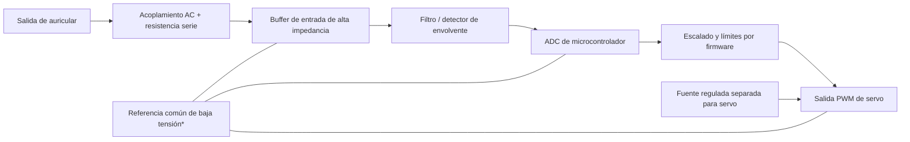

# Interfaz conceptual auricular → servo

> Diseño de laboratorio no certificado. Los valores analógicos, niveles, aislamiento y protecciones deben verificarse con el hardware real. No conectar directamente un auricular, el bus ARINC 429 ni un UART al servo.

## Bloques recomendados

`*` Solo cuando la arquitectura de aislamiento lo permita. Si se requiere separar tierra de audio y potencia, utilizar aislamiento galvánico diseñado para la señal, no unir retornos por intuición.

## Guía funcional

1. **Entrada de alta impedancia:** usar un amplificador operacional/buffer compatible con alimentación simple, con impedancia de entrada alta (por ejemplo, ≥100 kΩ como punto de partida), resistencia serie y protección de entrada dimensionada. Confirmar que no cargue el auricular ni supere el rango permitido del op-amp/ADC.
2. **Acoplamiento y polarización:** el condensador de acoplamiento bloquea DC; la entrada del buffer se polariza a una referencia a mitad de alimentación para que audio bipolar pueda medirse con ADC unipolar. Calcular el corte RC para la banda útil y revisar tolerancias/fuga del condensador.
3. **Detección:** elegir explícitamente qué representa el audio: amplitud/envolvente, tono o una señal ya modulada. Un detector de envolvente con rectificador/filtrado entrega amplitud lenta; si se necesita frecuencia/forma de onda, muestrear con ADC y procesar digitalmente. Una tensión DC arbitraria del envío no debe conectarse al jack de audio.
4. **Control:** calibrar `valor de envío → nivel de audio → lectura ADC → posición`; limitar el resultado a un rango PWM seguro del servo, aplicar filtro y rampa, y definir el estado de fallo (PWM neutro/deshabilitado).
5. **Potencia:** alimentar el servo con fuente adecuada a su corriente de arranque; añadir desacoplo cerca del conector y protección contra transitorios. No tomar corriente del pin de alimentación del microcontrolador. Mantener retorno de potencia separado del camino analógico y unir en un punto controlado si se usa referencia común.
6. **Prueba:** comenzar con generador de señal y carga de prueba, osciloscopio y servo desconectado; validar amplitud máxima, offset, ruido, saturación y fallo de cable. Conectar el servo al final.

## Advertencias y límite de esta aplicación

La aplicación web crea un valor y genera una palabra ARINC429. También reproduce en la salida del navegador un tono de 440 Hz; su nivel relativo se escala linealmente con el valor dentro del rango del instrumento:

$$x = \frac{valor - mínimo}{máximo - mínimo}, \qquad ganancia = 0.15x$$

Esto solo genera audio digital relativo. La tensión que entrega el auricular depende del DAC, volumen, carga y sistema operativo, por lo que no es una tensión calibrada ni una salida eléctrica garantizada. Para controlar el servo, medir y calibrar la señal real con el auricular y el volumen que se utilizarán; el buffer de alta impedancia y el ADC aíslan la entrada, y el microcontrolador produce el PWM del servo. Nunca conectar la salida de auricular directamente a un pin del ADC o al servo.

La transmisión serial de la demo entrega cuatro bytes por UART: no genera temporización, bipolaridad ni niveles eléctricos ARINC429. Al habilitar `SERIAL_ENABLED=true`, la creación de un envío intenta transmitir automáticamente; debe usarse solo con una interfaz de laboratorio compatible, limitada y aislada. Para un bus ARINC 429 real se necesita un transmisor apropiado.
